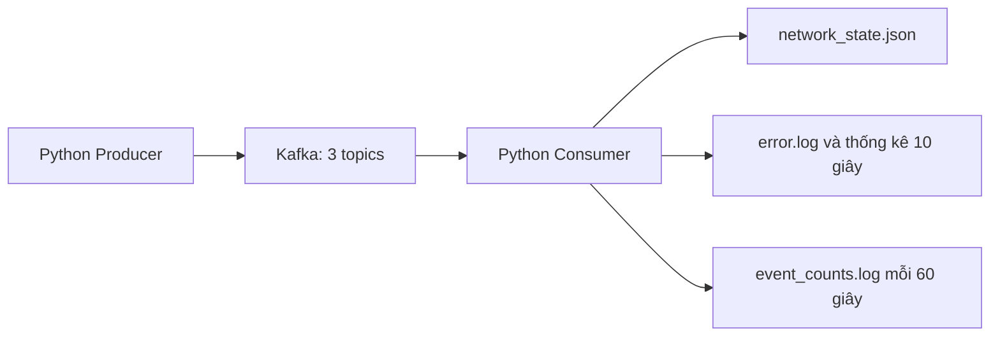

# Bài thực hành Kafka cho môn Xử lý phân tích dữ liệu trực tuyến - CSC17106

Mã nguồn thực hiện phần Bài tập gồm bài cơ bản theo dõi trạng thái mạng và cả hai bài nâng cao trên hệ điều hành Linux. Dữ liệu đầu vào được **giả lập**. 

## Đối chiếu yêu cầu và thiết kế

| Bài | Yêu cầu | Thực hiện |
| --- | --- | --- |
| Cơ bản | Producer gửi trạng thái thiết bị | `producer.py`, chế độ `network`, giả lập server/router/switch |
| Cơ bản | Consumer đọc và hiển thị | `consumer.py`, chế độ `network`, hiển thị chuyển trạng thái |
| Cơ bản | Kiểm tra Online/Offline và lưu trạng thái hiện tại | `domain.py::NetworkState`, JSON theo `device_id`, khôi phục khi chạy lại |
| Nâng cao 1 | INFO/ERROR/DEBUG, topic app-logs, đủ 4 trường | Producer chế độ `logs`; có thêm header `log_level` |
| Nâng cao 1 | Ưu tiên ERROR và ghi error.log | Consumer xử lý ERROR trước trong batch; ghi `error.log` ngay |
| Nâng cao 1 | In số lượng từng mức mỗi 10 giây | `WindowCounter`, xuất màn hình và `log_counts.jsonl` |
| Nâng cao 2 | Gửi user_id/event_type/item_id/timestamp | Producer chế độ `events`, topic `user-events` |
| Nâng cao 2 | Custom Partitioner click→0, view→1, purchase→2 | `domain.py::event_partitioner`, truyền partition vào lệnh produce |
| Nâng cao 2 | Đếm mỗi phút, ghi kết quả | Consumer `events`, cửa sổ 60 giây, file `event_counts.log` |

Mã dùng chung cho ba chế độ, tránh lặp cấu hình producer, consumer, kiểm tra lỗi và đóng kết nối.



## 1. Cài đặt và khởi động

Chạy các lệnh dưới đây từ thư mục chứa README này. Môi trường đã được cài tại `.runtime/` và `.venv/`; trên máy hiện tại có thể bắt đầu từ lệnh `start`.

```bash
# Chỉ cần khi chuẩn bị môi trường lần đầu:
bash scripts/setup.sh

# Khởi động ZooKeeper, Kafka và tạo/kiểm tra 3 topic:
bash scripts/kafka.sh start
bash scripts/kafka.sh status
```

Script cài OpenJDK 17, Kafka **3.9.1 / Scala 2.13** và `confluent-kafka==2.12.0` riêng trong thư mục bài tập, không đổi Java 25 đang có trên hệ thống. Cần Linux x86_64, Python 3.10+, hỗ trợ `venv`, `curl`, `tar`, `sha256sum` và mạng khi tải lần đầu. Trên Ubuntu/Debian thiếu công cụ có thể cài bằng `sudo apt install python3 python3-venv curl tar`.

JDK được tải từ Adoptium và xác minh SHA256 trong metadata. Kafka ưu tiên Apache Archive; nếu timeout thì tải qua Huawei Cloud mirror và so với **SHA512 cố định từ Apache**, có ghi URL nguồn trong script. Kafka và ZooKeeper chỉ lắng nghe trên loopback `127.0.0.1`, tại cổng 9092 và 2181. Nếu cổng đã bị dịch vụ khác chiếm, script dừng và báo lỗi.

Kafka 3.9.1 được chọn để thực hành đúng mô hình ZooKeeper trong PDF. Kafka 4.x đã bỏ ZooKeeper; không thay đường dẫn sang bản 4.x khi chạy các script này. [Apache Quick Start 3.9](https://kafka.apache.org/39/getting-started/quickstart/), [thay đổi từ Kafka 4.0](https://kafka.apache.org/40/getting-started/upgrade/).

| Topic | Partitions | Replication factor | Cleanup policy | Key |
| --- | ---: | ---: | --- | --- |
| `network-status` | 3 | 1 | `compact` | `device_id` |
| `app-logs` | 3 | 1 | `delete` | `service_name` |
| `user-events` | 3 | 1 | `delete` | `user_id`, partition do hàm Python quyết định |

Cấu hình sinh tại `.runtime/config/`. Dữ liệu broker nằm trong `.runtime/data/`, log vận hành trong `.runtime/logs/`. Giữ các thư mục này để tiếp tục dùng dữ liệu sau khi khởi động lại.

Môi trường đã kiểm thử: **Linux x86_64, Python 3.13.5, OpenJDK Temurin 17.0.20.1, Kafka 3.9.1 và confluent-kafka 2.12.0**. Mô hình một broker không có khả năng chịu lỗi bằng replication.

## 2. Bài cơ bản: Theo dõi trạng thái thiết bị

Mở **hai terminal**, cùng ở thư mục bài tập. Terminal thứ nhất:

```bash
.venv/bin/python -m kafka_lab.consumer network
```

Terminal thứ hai:

```bash
.venv/bin/python -m kafka_lab.producer network --count 18 --interval 1
```

Producer mô phỏng server, router và switch. Cứ mỗi lượt 3 thiết bị, trạng thái đổi giữa `Online` và `Offline`. `--count 0` (mặc định) gửi liên tục; Ctrl+C dừng. Thông điệp ví dụ:

```json
{"device_id":"router-01","device_type":"router","status":"Online","timestamp":"2026-10-16T15:00:00+00:00"}
```

Consumer hiển thị chuyển trạng thái, kiểm tra chỉ chấp nhận `Online`/`Offline`, lưu trạng thái hiện tại của mỗi thiết bị vào `output/network_state.json` và đọc lại file khi khởi động. Timestamp cũ hơn trạng thái đang lưu sẽ bị bỏ qua. File được thay thế nguyên tử sau mỗi cập nhật. Kafka key cố định theo thiết bị giúp giữ thứ tự thông điệp của cùng thiết bị trong một partition.

Phần giả lập nằm ở `make_record()` trong `kafka_lab/producer.py`. Có thể thay phần này bằng dữ liệu từ agent hoặc phép kiểm tra mạng thật; các trường JSON và consumer giữ nguyên.

## 3. Nâng cao bài 1: Log tập trung

Terminal thứ nhất:

```bash
.venv/bin/python -m kafka_lab.consumer logs
```

Terminal thứ hai:

```bash
.venv/bin/python -m kafka_lab.producer logs --count 30 --interval 1
```

Producer luân phiên `INFO`, `ERROR`, `DEBUG` cho các service `web`, `auth`, `payment`, gửi vào `app-logs`. Payload chứa đủ `log_level`, `service_name`, `message`, `timestamp`. Header Kafka `log_level` chứa cùng mức độ với payload; consumer kiểm tra nếu header có mặt.

Consumer lấy tối đa 100 thông điệp mỗi batch, xử lý các bản ghi `ERROR` trước các mức còn lại, ghi ngay vào `output/error.log` và in dòng `[ƯU TIÊN ERROR]`. Ưu tiên này áp dụng **trong batch đã nhận**; Kafka không cung cấp hàng đợi ưu tiên toàn topic. Sau mỗi **10 giây**, consumer in số lượng từng mức trong cửa sổ vừa kết thúc và ghi vào `output/log_counts.jsonl`. Khi không có dữ liệu mới, vẫn xuất cửa sổ với số đếm 0.

### Consumer group và compaction

Ví dụ chạy song song hai consumer cùng group, mỗi process lưu kết quả riêng:

```bash
# Terminal A
.venv/bin/python -m kafka_lab.consumer logs --group logs-workers --output-dir output/worker-a

# Terminal B
.venv/bin/python -m kafka_lab.consumer logs --group logs-workers --output-dir output/worker-b
```

Topic có 3 partition nên tối đa 3 consumer trong cùng group có thể nhận partition đồng thời. Các số đếm và file là của **từng process**, không phải tổng toàn group; muốn tổng tập trung cần thêm tầng tổng hợp. Với một consumer mặc định, thống kê bao phủ cả topic. Không cho nhiều network consumer ghi chung một `network_state.json`.

`app-logs` dùng `delete` vì cần giữ lịch sử log trong thời gian retention (7 ngày). `compact` chỉ giữ giá trị mới nhất theo key sau khi background cleaner chạy, nên dùng nó cho log có cùng service key sẽ làm mất lịch sử. Bài áp dụng `compact` cho `network-status`, nơi key là thiết bị và cần giữ trạng thái mới nhất. Compaction không xảy ra ngay khi nhận message. [Apache: Log Compaction](https://kafka.apache.org/39/design/design/#log-compaction).

## 4. Nâng cao bài 2: Hành vi người dùng

Terminal thứ nhất:

```bash
.venv/bin/python -m kafka_lab.consumer events
```

Terminal thứ hai:

```bash
.venv/bin/python -m kafka_lab.producer events --count 90 --interval 1
```

Payload chứa `user_id`, `event_type`, `item_id`, `timestamp`. Hàm **custom partitioner** `event_partitioner()` trong `kafka_lab/domain.py` ánh xạ cố định:

| event_type | Partition |
| --- | ---: |
| `click` | 0 |
| `view` | 1 |
| `purchase` | 2 |

Producer đọc metadata để xác nhận topic có đúng 3 partition, gọi hàm partitioner rồi truyền kết quả vào `Producer.produce(partition=...)`. Thư viện `confluent-kafka` không nhận Python callable qua cấu hình `partitioner`; truyền partition tường minh là cách sử dụng hàm tùy biến trong bài này. [Confluent Producer API](https://docs.confluent.io/platform/current/clients/confluent-kafka-python/html/index.html#confluent_kafka.Producer.produce).

Consumer kiểm tra loại sự kiện khớp partition thực tế, đếm theo từng loại trong mỗi **60 giây**, in màn hình và ghi `output/event_counts.log` dạng JSON Lines. Cửa sổ là **processing time**, tính từ lúc consumer bắt đầu, không phải nhóm theo timestamp của sự kiện hoặc căn phút đồng hồ. Khi dừng bình thường có dữ liệu còn lại, consumer xuất thêm bản thống kê `partial: true`.

Do partition dựa trên loại sự kiện, các sự kiện khác loại của cùng một user có thể nằm ở các partition khác nhau; không có thứ tự tổng thể giữa chúng.

## 5. Các lệnh Kafka cơ bản trên Linux

Sau khi đã chạy `start`, trong terminal:

```bash
export JAVA_HOME="$PWD/.runtime/jdk-17"
export PATH="$JAVA_HOME/bin:$PATH"
KAFKA="$PWD/.runtime/kafka_2.13-3.9.1"

# Tạo topic thử nghiệm, xem danh sách và mô tả partition:
"$KAFKA/bin/kafka-topics.sh" --bootstrap-server 127.0.0.1:9092 \
  --create --if-not-exists --topic test --partitions 1 --replication-factor 1
"$KAFKA/bin/kafka-topics.sh" --bootstrap-server 127.0.0.1:9092 --list
"$KAFKA/bin/kafka-topics.sh" --bootstrap-server 127.0.0.1:9092 \
  --describe --topic user-events

# Nhập thông điệp, Enter để gửi, Ctrl+C để dừng:
"$KAFKA/bin/kafka-console-producer.sh" --bootstrap-server 127.0.0.1:9092 --topic test

# Mở terminal khác, đặt lại JAVA_HOME/KAFKA như trên rồi đọc:
"$KAFKA/bin/kafka-console-consumer.sh" --bootstrap-server 127.0.0.1:9092 \
  --topic test --from-beginning

# Xem consumer group và offset:
"$KAFKA/bin/kafka-consumer-groups.sh" --bootstrap-server 127.0.0.1:9092 \
  --describe --group events-group
```

Khác biệt và lỗi được sửa so với ví dụ PDF:

- Dùng `bin/*.sh` trên Linux thay cho `bin/windows/*.bat` và đường dẫn `C:\...`.
- Dùng JDK 17 tương thích, Python `venv`, và `time.sleep`/`producer.poll` thay cho dòng giả mã `// Sleep`; sửa chuỗi địa chỉ broker thiếu dấu nháy trong PDF.
- Replication factor là **1** cho mô hình chỉ có một broker. Không dùng mặc định 2 như đoạn cấu hình minh họa trong PDF.
- Giữ giao thức `PLAINTEXT` cho lab trên loopback. Dòng `security.inter.broker.protocol=SSL` trong PDF chỉ dùng khi đã cấu hình listener, keystore và truststore SSL đầy đủ.

## 6. Kiểm thử và xem kết quả

```bash
# 5 kiểm thử xử lý dữ liệu, không cần Kafka và không tải thư viện:
python3 -m unittest discover -s tests -v

# Khởi động broker, chạy các kiểm thử với Kafka thật, rồi dừng dịch vụ:
bash scripts/verify.sh

# Nếu broker đã chạy và muốn giữ nó sau khi kiểm thử:
.venv/bin/python scripts/integration_test.py
```

Kiểm thử tích hợp chạy khoảng 65–80 giây, dùng topic/group riêng cho mỗi lần chạy để không lẫn dữ liệu cũ. Nó gửi 6 trạng thái mạng, 9 log và 9 sự kiện, đọc lại từ Kafka để xác minh header/partition, gửi thêm 2 thông điệp lỗi, rồi kiểm tra cửa sổ 10 giây, cửa sổ rỗng và cửa sổ 60 giây thực tế. Toàn bộ stdout và file kết quả nằm ở `results/<run-id>/`; `summary.json` chỉ được tạo khi mọi kiểm tra đều đạt. Topic kiểm thử được giữ trong broker để có thể kiểm tra lại.

### Kết quả chạy thực tế

Bộ kiểm thử độc lập có **5 test**, kiểm tra lưu/khôi phục trạng thái và bỏ qua cập nhật cũ, ánh xạ partition, báo cáo đúng thời điểm và khi rỗng, thống kê cuối chưa đủ cửa sổ, cùng việc từ chối schema không hợp lệ.

Lần chạy tích hợp với broker thật được lưu tại [results/20261016T153802Z-fd268e/](results/20261016T153802Z-fd268e/). Kết quả máy đọc được nằm trong [summary.json](results/20261016T153802Z-fd268e/summary.json).

| Kiểm tra | Kết quả mong đợi và được kiểm tra tự động |
| --- | --- |
| Trạng thái thiết bị | 6 message, 3 thiết bị; trạng thái cuối mỗi thiết bị là Offline |
| Log ứng dụng | 9 message hợp lệ; INFO=3, ERROR=3, DEBUG=3 |
| File lỗi | 3 dòng, tất cả là ERROR |
| Header Kafka | Mức log trong header khớp payload của toàn bộ 9 message |
| Cửa sổ 10 giây kế tiếp không có dữ liệu | INFO=0, ERROR=0, DEBUG=0 |
| Dữ liệu lỗi | Cách ly 2 message: JSON lỗi và header khác payload |
| Sự kiện | 9 message; click=3, view=3, purchase=3 trong cửa sổ 60 giây đầy đủ |
| Phân vùng | Đọc trực tiếp từ Kafka và xác nhận click→0, view→1, purchase→2 |

Các file `*-producer.txt`, `*-consumer.txt` lưu stdout của ứng dụng; các thư mục `network/`, `logs/`, `events/` chứa dữ liệu đầu ra. Script chỉ tạo `summary.json` với `status: PASS` sau khi tất cả điều kiện đều đạt.

### File đầu ra và lưu ý xử lý

File đầu ra khi chạy thủ công:

| File | Nội dung |
| --- | --- |
| `output/network_state.json` | Trạng thái mới nhất theo thiết bị |
| `output/error.log` | Các log ERROR, mỗi dòng một JSON |
| `output/log_counts.jsonl` | Thống kê log mỗi 10 giây |
| `output/event_counts.log` | Thống kê sự kiện mỗi phút |
| `output/invalid_messages.jsonl` | Thông điệp sai schema/header/partition và vị trí trong Kafka |

Thông điệp không hợp lệ được ghi riêng rồi bỏ qua; lỗi ghi file hoặc lỗi Kafka làm consumer thoát thay vì im lặng commit dữ liệu chưa xử lý. Producer bật idempotence, chờ delivery callback và kiểm tra kết quả `flush()` trước khi báo gửi thành công. [Confluent Python client](https://docs.confluent.io/kafka-clients/python/current/overview.html).

Consumer tắt auto commit, commit sau khi xử lý hết batch. Đây là lab dùng file và bộ đếm trong RAM: nếu process chết giữa xử lý và commit, log có thể lặp; nếu chết trước khi xuất thống kê, bộ đếm đang giữ trong RAM có thể mất. Khi chia group/rebalance, thống kê vẫn chỉ là dữ liệu từng process đã xử lý. Không bảo đảm exactly-once cho file hoặc thống kê khi có sự cố. Timestamp dữ liệu dùng UTC có múi giờ.

Consumer mặc định giữ offset theo group. Muốn đọc lại lịch sử, dùng group mới, ví dụ `--group events-replay-01`, và `--output-dir output/replay-01` để tách kết quả. `auto.offset.reset=earliest` chỉ có tác dụng khi group chưa có offset hợp lệ.

## 7. Dừng và xử lý sự cố

Ctrl+C để dừng producer/consumer; consumer đóng kết nối, producer chờ gửi hết hàng đợi. Dừng Kafka trước ZooKeeper:

```bash
bash scripts/kafka.sh stop
```

Nếu không kết nối được broker, kiểm tra `bash scripts/kafka.sh status` và `.runtime/logs/kafka.out`, `.runtime/logs/zookeeper.out`. Không chạy `setup.sh` bằng `sudo`. Trong môi trường Codex có sandbox chặn socket, chạy Kafka và kiểm thử cần quyền thực thi ngoài sandbox; terminal Linux thông thường không có giới hạn này. Môi trường công cụ có thể thu hồi tiến trình nền khi lệnh kết thúc; `verify.sh` giữ khởi động và kiểm thử trong cùng phiên để xử lý trường hợp đó.
